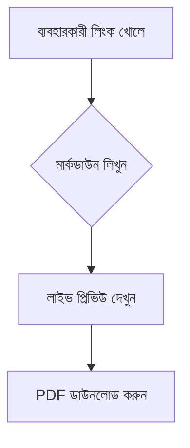

# 📝 লেখা → পিডিএফ (Markdown to PDF Editor)

A modern, fast, client-side **Bangla & English Markdown Editor** built with Next.js 14, TypeScript, Tailwind CSS, and shadcn/ui. Write markdown with rich Bengali typography, render live Mermaid diagrams, upload custom fonts, and export high-quality vector PDFs natively from your browser.


---

## ✨ Features

- 🇧🇩 **Bangla & English Support**: Native font pairing optimized for complex Bangla script shaping, conjuncts, matra placement, and multi-language documents.
- 🎨 **Typography Presets**: 
  - **Classic**: Serifs (*Tiro Bangla* + *Lora* / *Hind Siliguri*)
  - **Modern**: Clean Sans (*Inter* + *Hind Siliguri*)
  - **Boi (বই)**: Book style typography with justified text and paragraph indentations (*Noto Sans Bengali* + *Tiro Bangla*).
- 🔤 **Custom Font Upload**: Upload `.ttf`, `.otf`, `.woff`, or `.woff2` files dynamically. Applied instantly across the editor, preview, and exported PDF.
- 📊 **Mermaid Diagrams**: Native client-side rendering for flowchart and diagram code fences (` ```mermaid `).
- 💻 **Syntax Highlighting**: Code blocks with automatic language detection powered by `highlight.js` (Atom One Dark theme).
- 📄 **Vector PDF Export**: Uses browser-native `@page` print pipeline. Results in lightweight, searchable vector text with perfect script rendering — no blurry images or bloated canvas screenshots.
- 👁️ **Flexible View Modes**: Switch between Editor Only, Live Preview Only, or Split View, with a wide container toggle for spacious editing.
- 🔒 **100% Client-Side & Private**: No backend, no API tracking, and no external server uploads. Your data and fonts stay inside your browser session.

---

## 🛠️ Stack

- **Framework**: [Next.js 14](https://nextjs.org/) (App Router) & [TypeScript](https://www.typescriptlang.org/)
- **Styling**: [Tailwind CSS](https://tailwindcss.com/) & [shadcn/ui](https://ui.shadcn.com/) (Radix primitives)
- **Markdown Parser**: [Marked](https://marked.js.org/) & [DOMPurify](https://github.com/cure53/DOMPurify)
- **Diagrams**: [Mermaid.js](https://mermaid.js.org/)
- **Syntax Highlighting**: [highlight.js](https://highlightjs.org/)
- **Icons**: [Lucide React](https://lucide.dev/)

---

## 🚀 Getting Started

### Prerequisites

- Node.js 18.x or later
- `npm` / `pnpm` / `bun` / `yarn`

### Installation

1. **Clone the repository:**
   ```bash
   git clone https://github.com/AbdullahAlMaksud/markdown-editor-bangla.git
   cd markdown-editor-bangla
   ```

2. **Install dependencies:**
   ```bash
   npm install
   # or
   bun install
   ```

3. **Run the development server:**
   ```bash
   npm run dev
   # or
   bun dev
   ```

4. Open [http://localhost:3000](http://localhost:3000) in your browser. Click the floating top-left menu icon to open the configuration drawer.

---

## 📖 Usage Guide

### Custom Fonts
Click **"পছন্দের ফন্ট আপলোড" (Upload Custom Font)** in the sidebar drawer and choose any font file (`.ttf`, `.otf`, `.woff`, `.woff2`). The font will instantly be registered using the browser FontFace API and applied to headings and body text.

### Diagramming with Mermaid
Fence your code block with `mermaid`:



### Exporting PDF
1. Click **"PDF ডাউনলোড"** in the sidebar.
2. The browser print modal will appear pre-configured for the document.
3. Select **"Save as PDF"** as the destination.
4. Save your vector-rendered PDF document.

---

## 📁 Project Structure

```text
app/
├── globals.css         # Typography, CSS variables, and print stylesheets
├── layout.tsx          # Root layout and Google Font imports
└── page.tsx            # Main page wrapper
components/
├── markdown-pdf-editor.tsx # Main editor component & state management
└── ui/                 # shadcn UI components (Sheet, Button, Select, etc.)
lib/
└── utils.ts            # Tailwind classnames merger utility
```

---

## 📄 License

Distributed under the MIT License. See `LICENSE` for details.
