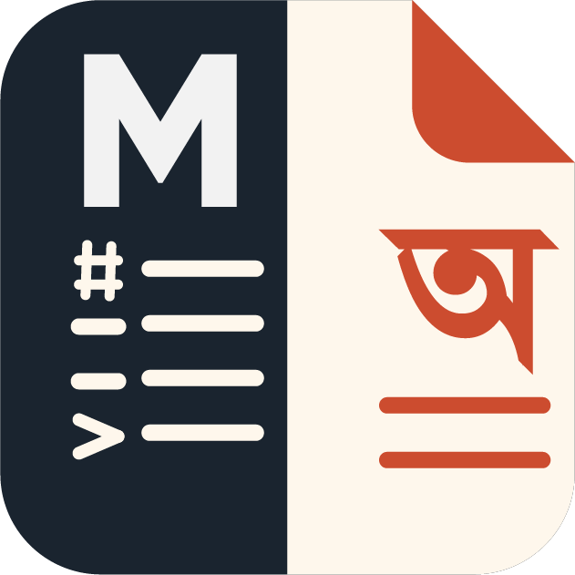

# 📝 MarkBangla — বাংলা ও ইংরেজি মার্কডাউন এডিটর এবং পিডিএফ এক্সপোর্টার

<div align="center">



**MarkBangla** একটি আধুনিক, দ্রুতগতির ও শক্তিশালী বাংলা ও ইংরেজি মার্কডাউন এডিটর। এতে রয়েছে লাইভ প্রিভিউ, ৮টি আকর্ষণীয় থিম, মারমেইড চার্ট রেন্ডারিং, ড্র্যাগেবল স্প্লিট স্ক্রিন, কাস্টম ফন্ট আপলোড, ভেক্টর কোয়ালিটি PDF ও Markdown এক্সপোর্ট এবং ক্লাউড ডাটাবেজ শেয়ারিং সুবিধা।

[](https://bun.sh)
[](https://nextjs.org/)
[](https://www.typescriptlang.org/)
[](https://tailwindcss.com/)
[](https://www.mongodb.com/)
[](LICENSE)

</div>

---

## ✨ মূল বৈশিষ্ট্যসমূহ (Features)

- 🇧🇩 **বাংলা ও ইংরেজি মিশ্রিত স্ক্রিপ্ট সমর্থন**: নিখুঁত যুক্তাক্ষর ও জটিল বাংলা স্ক্রিপ্ট রেন্ডারিং অপ্টিমাইজেশন (*Tiro Bangla*, *Hind Siliguri*, *Noto Sans Bengali*, *Lora*, *Inter*)।
- ⚖️ **ইন্টারেক্টিভ স্প্লিট স্ক্রিন ও রিসাইজ হ্যান্ডেল**: 
  - শুরুতে সমান ৫০%-৫০% উইডথ।
  - মাউস বা টাচ দিয়ে ড্র্যাগ করে ইচ্ছামতো সাইজ পরিবর্তন।
  - হ্যান্ডেলারে এক ক্লিকে যেকোনো একটি প্যানেল হাইড বা ফুলস্ক্রিন করার সুবিধা।
  - উভয় প্রান্তে তাৎক্ষণিক আনহাইড/ডক বাটন।
- 🎨 **৮টি প্রিমিয়াম থিম ও প্রিসেট**:
  1. **ক্লাসিক (Classic Serif)**: ঐতিহ্যবাহী ও মার্জিত সেরিফ লুক।
  2. **আধুনিক (Modern Teal)**: ঝকঝকে সান-সেরিফ ও টিল অ্যাকসেন্ট।
  3. **বই ও সাহিত্য (Book / Sepia)**: ভিন্টেজ ক্রিম পেপার (`#FBF6EA`), ইন্ডেন্টেড প্যারাগ্রাফ ও জাস্টিফায়েড টেক্সট।
  4. **ডার্ক অবসিডিয়ান (Dark Obsidian)**: রাতের বেলা কোডিং ও রিডিংয়ের জন্য ডার্ক ক্যানভাস।
  5. **মিনিমালিস্ট নর্ডিক (Minimalist Nordic)**: পরিচ্ছন্ন স্লেট স্টাইল।
  6. **গোলাপী ও কবিতা (Rose & Poetry)**: সফট ব্লাশ পেপার টিন্ট ও রোজ অ্যাকসেন্ট।
  7. **একাডেমিক পেপার (Academic Paper)**: রিসার্চ পেপার বা থিসিস ফরম্যাট।
  8. **সাইবার গ্রিন (Cyber Terminal)**: ম্যাট্রিক্স ডার্ক থিম ও এমারেল্ড গ্লো।
- 🔗 **ক্লাউড ডকুমেন্ট শেয়ারিং (`/share/[id]`)**:
  - ১-ক্লিকেই ডাটাবেজে ফাইল সেভ করে ইউনিক শেয়ার লিংক তৈরি।
  - সোশাল মিডিয়ায় শেয়ার করলে আকর্ষণীয় প্রিভিউ কার্ড প্রদর্শিত হয়।
  - শেয়ারকৃত লিংক থেকে যে কেউ পড়তে পারবে এবং **"✏️ এডিটরে খুলুন"** বাটনে চাপ দিয়ে সাথে সাথে এডিট করতে পারবে।
- 📊 **মারমেইড ডায়াগ্রাম (Mermaid.js)**: ফ্লোচার্ট ও ডায়agram লাইভ কোডব্লক থেকে আসল SVG ফ্লোচার্ট রেন্ডার।
- 📄 **ভেক্টর কোয়ালিটি PDF এক্সপোর্ট**: ব্রাউজারের নেটিভ `@page` ভেক্টর প্রিন্ট ইঞ্জিন ব্যবহার করে হালকা ও শার্প PDF তৈরি হয়।
- ⬇️ **Markdown (.md) ফাইল ডাউনলোড**: লেখার প্রথম হেডিং অনুসারে স্বয়ংক্রিয় নামকরণে UTF-8 ফরম্যাটে `.md` ফাইল ডাউনলোড।
- 🔤 **কাস্টম ফন্ট আপলোড**: আপনার পছন্দের যেকোনো `.ttf`, `.otf`, `.woff`, `.woff2` ফন্ট আপলোড করে সাথে সাথে ব্যবহার করার সুবিধা।
- 📏 **লাইভ পেজ সাইজ ও ডায়নামিক পেজ কাউন্টার**: A4 বা Letter পেজে আনুমানিক কত পেজ প্রিন্ট হবে তা রিয়েল-টাইমে হিসাব করে প্রদর্শন।
- 🖱️ **কাস্টম ন্যারো স্ক্রোলবার**: পুরো প্রজেক্টে ৬ পিক্সেল মসৃণ ও আধুনিক ন্যারো স্ক্রোলবার।

---

## 🛠️ প্রযুক্তি ও টেক স্ট্যাক (Tech Stack)

- **রানটাইম ও প্যাকেজ ম্যানেজার**: [Bun](https://bun.sh/)
- **ফ্রেমওয়ার্ক**: [Next.js 14](https://nextjs.org/) (App Router, Server Components & Dynamic API Routes)
- **ভাষা**: [TypeScript](https://www.typescriptlang.org/)
- **স্টাইলিং**: [Tailwind CSS](https://tailwindcss.com/) & [shadcn/ui](https://ui.shadcn.com/)
- **ডাটাবেজ**: [MongoDB Atlas](https://www.mongodb.com/) (অফিসিয়াল ড্রাইভার ও রেজিলিয়েন্ট লোকাল ফলব্যাক)
- **ডায়াগ্রাম ও হাইলাইটিং**: [Mermaid.js](https://mermaid.js.org/) ও [highlight.js](https://highlightjs.org/)
- **আইকনস**: [Lucide React](https://lucide.dev/)

---

## 🚀 শুরু করার নিয়ম (Getting Started with Bun)

### ১. রিপোজিটরি ক্লোন করুন
```bash
git clone https://github.com/AbdullahAlMaksud/markdown-editor-bangla.git
cd markdown-editor-bangla
```

### ২. ডিপেন্ডেন্সি ইনস্টল করুন (Bun ব্যবহার করে)
```bash
bun install
```

### ৩. এনভায়রনমেন্ট কনফিগারেশন
রুট ফোল্ডারে `.env.local` ফাইল তৈরি করে আপনার MongoDB Atlas কানেকশন স্ট্রিং দিন:

```env
# MongoDB Connection String
MONGODB_URI=mongodb+srv://<username>:<password>@cluster0.abcde.mongodb.net/markdown_app?retryWrites=true&w=majority

# App Base URL (লোকালে http://localhost:3000)
NEXT_PUBLIC_APP_URL=http://localhost:3000
```
*(নোট: কানেকশন স্ট্রিং না দিলেও স্বয়ংক্রিয় লোকাল স্টোরেজ ফলব্যাক দিয়ে অ্যাপ কাজ করবে)*

### ৪. ডেভেলপমেন্ট সার্ভার চালু করুন
```bash
bun dev
```
ব্রাউজারে [http://localhost:3000](http://localhost:3000) ওপেন করুন।

### ৫. প্রোডাকশন বিল্ড তৈরি করুন
```bash
bun run build
bun run start
```

---

## 📂 প্রজেক্ট স্ট্রাকচার (Project Structure)

```text
├── public/
│   └── images/             # লোগো ও সোশ্যাল মিডিয়া ওপেনগ্রাফ অ্যাসেটস
├── src/
│   ├── app/
│   │   ├── api/
│   │   │   └── share/      # ডকুমেন্ট সেভ ও রিট্রিভ করার ব্যাকেন্ড API
│   │   ├── share/[id]/     # শেয়ারকৃত ডকুমেন্টের পাবলিক ভিউ পেজ
│   │   ├── globals.css     # গ্লোবাল স্টাইল, থিমস ও কাস্টম স্ক্রোলবার
│   │   ├── layout.tsx      # রুট লেআউট ও সোশ্যাল মেটা ট্যাগস
│   │   └── page.tsx        # মূল এডিটর পেজ
│   ├── components/
│   │   ├── markdown-pdf-editor.tsx # মূল এডিটর ও স্প্লিট-ভিউ কম্পোনেন্ট
│   │   └── ui/             # রি-ইউজেবল UI কম্পোনেন্টস (Sheet, Select, Button, ইত্যাদি)
│   └── lib/
│       ├── db.ts           # MongoDB ক্লায়েন্ট ও রেজিলিয়েন্ট ফলব্যাক স্টোরেজ
│       └── utils.ts        # Tailwind CSS ক্লাস ইউটিলিটি
├── .env.example            # এনভায়রনমেন্ট ভেরিয়েবল টেমপ্লেট
├── .env.local              # লোকাল কনফিগারেশন ফাইল
└── README.md
```

---

## 🤝 অবদান (Contributing)

ওপেন সোর্স কমিউনিটিতে যেকোনো ধরণের অবদান অত্যন্ত স্বাগতম!
1. রিপোজিটরিটি Fork করুন
2. নতুন ফিচার ব্রাঞ্চ তৈরি করুন (`git checkout -b feature/AmazingFeature`)
3. পরিবর্তন Commit করুন (`git commit -m 'Add some AmazingFeature'`)
4. ব্রাঞ্চে Push করুন (`git push origin feature/AmazingFeature`)
5. একটি Pull Request ওপেন করুন

---

## 📄 লাইসেন্স (License)

এই প্রজেক্টটি **MIT License** এর অধীনে উন্মুক্ত। বিস্তারিত জানতে [LICENSE](LICENSE) ফাইলটি দেখুন।

---

<div align="center">
Made with ❤️ by <strong>Abdullah Al Maksud</strong>
</div>
